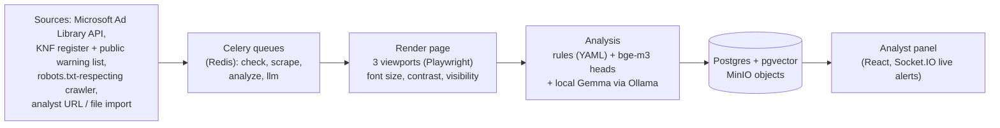

# InvestWatch

Automated monitoring of Polish investment advertising and finfluencer content, built for
**HackNation 2026, task "UKNF #InvestWatch"** (Polish Financial Supervision Authority). One
command, CPU-only by default, local models only: no data leaves the machine.

It covers the three modules of the task:

- **M1: third-party ads of KNF-registered firms.** Finds ads that promote a firm from the KNF registers but are published by someone else, and checks them against the register.
- **M2: risk-warning compliance (art. 44 of Delegated Regulation 2017/565).** Audits the *rendered* page, not just its HTML: 18 rules including risk-warning presence, font size, contrast, visibility within one click, and responsiveness across three viewports.
- **M3: unlicensed investment advice.** Flags content that meets the elements of investment advice under art. 76 of the Polish Act on Trading in Financial Instruments without a licence.

Findings land in an analyst panel (Polish UI) with evidence, rule-by-rule verdicts, a trend
chart, reports and per-module sensitivity. The organizer's task text and attachments are not
republished here; the rules we implemented are in `ai/src/investwatch_ai/rules/risk_rules.yaml` and described in
[docs/ARCHITECTURE.md](docs/ARCHITECTURE.md).

## Quick start without the model (lite, about 2 min)
Rules + lexicon only: no Ollama, no LLM, no embeddings, nothing to download beyond the base
images (about 5 GB unpacked: Playwright/Chromium for the renderer, Postgres, Node, Python,
nginx). Skips the Ollama image (8.5 GB unpacked) and the 5.5 GB of models.
```bash
git clone https://github.com/NikodemNowak/investwatch-uknf.git investwatch && cd investwatch
cp .env.example .env             # set POSTGRES_PASSWORD and MINIO_ROOT_PASSWORD
make up-lite                     # = docker compose -f docker-compose.yml -f docker-compose.lite.yml up --build
make demo-lite                   # second terminal: synthetic demo through the real pipeline
```
Measured on the i7-13700KF PC (no GPU), base images and package caches already present:
`build --no-cache` 45 s, up to a healthy dashboard 36 s (**82 s in total**), `make demo-lite`
30 s, "Sprawdź" of `http://demo-sites/hidden-risk.html` about 5 s to a high-risk M2 finding with
9 violated rules. On a fresh machine add the download of the base images. Images on disk: about
6.3 GB (backend 4.1 GB, ai 1.0 GB, the rest under 1 GB).

What you lose:
- **The LLM second opinion.** Findings say "Ocena modelu niedostępna: wynik z reguł"; the
  monitoring panel shows Ollama as "wyłączone" (not an error) and expects no `worker-llm`.
- **bge-m3 embeddings.** `EMBED_ENABLED=false`: no vectors are stored, so "similar posts" and
  near-duplicate detection by cosine stay empty; the M1 / M3 heads use their lexicon variant
  (same trained thresholds).

Hold-out F1 (compliant sources, same split and labels as [docs/eval/latest.md](docs/eval/latest.md);
n = 13 / 41 / 22 with 6 / 16 / 3 positives, so one item moves M1 by about 0.1):

| Module | Rules only (`eval --no-classifier`) | Lite runtime (rules + lexicon heads) | Full (bge-m3 heads, LLM) |
|---|---|---|---|
| M1 third-party ad | 0.92 | 1.00 | 0.83 |
| M2 risk disclosure | 0.82 | 0.82 | 0.80 |
| M3 shadow advisory | 0.50 | 0.50 | 0.55 |

The first two columns were re-run on this commit; the full column is the committed report
(computed at an earlier commit with Ollama). On this small hold-out the lite variant is not
measurably worse; the model's value is the second opinion on ambiguous M2 / M3 rules and
similarity search over stored posts, which the hold-out F1 barely sees.

## Quick start (full, with the local model)
Needs Docker with Compose v2.24+, `git`, `make` for the demo targets, about 25 GB free disk and
internet for the first run (about 15 GB of images including the 8.5 GB Ollama image, plus
5.5 GB of models: `gemma4:e2b-it-qat` 4.3 GB and bge-m3 1.2 GB).
```bash
git clone https://github.com/NikodemNowak/investwatch-uknf.git investwatch && cd investwatch
cp .env.example .env             # set POSTGRES_PASSWORD and MINIO_ROOT_PASSWORD (compose refuses to start without them)
docker compose up --build        # dashboard http://localhost:8080, API docs http://localhost:8000/docs
# in a second terminal, once the dashboard answers:
make demo                        # reset the database and replay the demo through the real pipeline (~70 s)
make demo-real                   # the same + real data fetched live (official APIs, robots.txt); ~25 min
```
GPU (optional, needs the NVIDIA Container Toolkit):
`docker compose -f docker-compose.yml -f docker-compose.gpu.yml up --build`.

`make demo` loads no ready-made findings: it replays demo material through the real pipeline
(details in [docs/OPERATIONS.md](docs/OPERATIONS.md)). Without `make`:
`docker compose exec api python -m investwatch.demo` (add `--real` for `demo-real`). Fictional
material is labelled "dane syntetyczne" / "firma fikcyjna (demo)" in the UI. `make demo-real`
adds real ads from the Microsoft Ad Library API with their landing pages, registered firms'
pages and live sites from the KNF warning list ([docs/DATA_ACCESS.md](docs/DATA_ACCESS.md)).

First use: open http://localhost:8080, paste `http://demo-sites/hidden-risk.html` into
"Sprawdź" and watch the alert arrive; "Do przejrzenia" lists findings with a trend chart. The
dashboard works while the models download; findings are marked `llm_review=unavailable` and
reviewed by the model once it is there.

## How it works

Rules give a verdict immediately (about 1.5 s); the local LLM reviews the finding afterwards
and its verdict is shown separately. Thresholds are trained on a train split and the dashboard
starts with the same values as the evaluation. Details: [docs/ARCHITECTURE.md](docs/ARCHITECTURE.md).

### Legal data sources only
Microsoft Ad Library API (public EU ad repository), the KNF registers and public warning list,
and a crawler that obeys robots.txt with per-domain rate limits and an honest user agent.
YouTube, Meta and TikTok are used only through their official APIs with the owner's own keys
(`YOUTUBE_API_KEY`, `META_AD_LIBRARY_TOKEN`, `TIKTOK_*`); without a key the source reports
"wymaga klucza" instead of scraping. See [ADR 0008](docs/decisions/0008-official-data-access.md)
and [ADR 0009](docs/decisions/0009-fair-treatment-of-real-firms.md).

## Evaluation (honest)
Hold-out split (40%, split by domain / author / firm), compliant sources only, 185 labelled
items in total. Labels come from AI-agent consensus following written rules, not from UKNF or
human experts; the set is small, so intervals are wide. Full tables, per-rule metrics and
ablation: [docs/eval/latest.md](docs/eval/latest.md); labelling method:
[docs/eval/LABELING.md](docs/eval/LABELING.md).

| Module | n (positives) | Precision | Recall | F1 [95% CI] | Threshold |
|---|---|---|---|---|---|
| M1 third-party ad | 13 (6) | 0.83 | 0.83 | 0.83 [0.50, 1.00] | 0.20 |
| M2 risk disclosure | 41 (16) | 0.74 | 0.88 | 0.80 [0.64, 0.93] | 0.30 |
| M3 shadow advisory | 22 (3) | 0.38 | 1.00 | 0.55 [0.00, 0.86] | 0.12 |

M3 has only 3 positives in the hold-out: treat it as a weak, recall-oriented signal. Reproduce
with `make eval`.

### Hosted demo
A copy runs on the team's GPU PC behind HTTP basic auth. The URL and login are given in the
submission, not in this repository. It is the same code as `docker compose up`.

### Measured timings
| Step (fresh clone, i7-13700KF, no GPU, base images already pulled) | Time |
|---|---|
| `git clone` → dashboard and API answer | 67 s |
| … → local LLM ready (bge-m3 + `gemma4:e2b-it-qat` pulled) | 227 s |
| `make demo` on the running stack | about 70 s |
| "Sprawdź" → alert (rules) / → model verdict (empty model queue) | 1.4-1.6 s / +13 s |
| "Sprawdź" during `make demo` (23-30 demo reviews queued) → rules / → model verdict | 5.2 s / 32 s (batch backlog drained after about 6 min) |

Development servers, more timings and troubleshooting: [docs/OPERATIONS.md](docs/OPERATIONS.md).

## Hardware
| | Minimum | Recommended |
|---|---|---|
| CPU | 4 cores x86-64 (AVX2) | 8+ cores |
| RAM | 8 GB (`AI_MODE=rules`), 10 GB with the LLM | 16 GB |
| Disk | 25 GB free | 40 GB |
| GPU | none | NVIDIA ≥ 12 GB VRAM for `docker-compose.gpu.yml` (12B model) |

Measured: Ollama 5.0 GB of models resident with `OLLAMA_NUM_PARALLEL=2` (gemma4:e2b 3.8 GB +
bge-m3 1.2 GB; the second slot costs about 0.2 GB of context) plus runtime, within the 6.6 GB
measured before; all other services about 2 GB (with `worker-check`); images about 15 GB,
models 5.5 GB.

## Services
| Service | Role | Port |
|---|---|---|
| `frontend` | React dashboard (nginx) | 8080 |
| `api` | FastAPI + Socket.IO | 8000 |
| `worker-check`, `worker-scrape`, `worker-analyze`, `worker-llm`, `beat` | Celery queues and scheduler (`check` + `llm_priority`: analyst checks first) | internal |
| `ai` | preprocessing, rules, scoring, classifiers, LLM client | internal |
| `ollama`, `ollama-init` | local models (pulled in the background) | internal |
| `postgres` (pgvector), `redis` (Valkey), `minio` | metadata + vectors, broker, objects | internal |
| `seed`, `demo-sites` | migrations, KNF register, demo sources, calibration labels; fictional test pages | internal |

## Configuration
All settings come from `.env`; `.env.example` documents every variable.

| Variable | Default | Meaning |
|---|---|---|
| `POSTGRES_PASSWORD`, `MINIO_ROOT_PASSWORD` | none (required) | compose refuses to start without them |
| `AI_MODE` | `llm` | `llm` (rules now, model review later) / `rules` (no model) / `mock` |
| `LLM_MODEL`, `GPU_LLM_MODEL`, `EMBED_MODEL` | `gemma4:e2b-it-qat`, `gemma3:12b`, `bge-m3` | Ollama models |
| `THRESHOLD_M1`, `THRESHOLD_M2`, `THRESHOLD_M3` | 0.20 / 0.30 / 0.12, trained on the train split | alert thresholds; the dashboard starts with the same values as `docs/eval/latest.md` (screen = evaluation); editable in "Czułość" |
| `YOUTUBE_API_KEY`, `META_AD_LIBRARY_TOKEN`, `TIKTOK_CLIENT_KEY/SECRET` | empty | official platform APIs; without them the source shows "wymaga klucza" |
| `COLLECTOR_MIN_INTERVAL_S`, `COLLECTOR_PROXY_URLS`, `COLLECTOR_USER_AGENTS` | `2`, empty, empty | crawler politeness, egress proxies, honest UA pool |
| `RENDER_ENABLED` | `true` | Playwright visual audit (screenshots, font size, contrast) |

## Security
Secrets only in `.env`; `make audit` runs pip-audit and npm audit; CI blocks on gitleaks (full
history), pip-audit, npm audit and critical Trivy findings in all four images, and keeps a
CycloneDX SBOM per image. Scans on 2026-11-21: 0 known vulnerabilities in Python and npm
dependencies, 0 critical in images, no leaks. Details: [docs/SECURITY.md](docs/SECURITY.md).

## Repository map
| Path | Contents |
|---|---|
| `backend/` | Python 3.12 FastAPI + Socket.IO API, Celery workers and beat, collectors, storage (package `investwatch`) |
| `ai/` | separate FastAPI service `investwatch_ai`: preprocessing, rules (YAML), scoring, classifiers, LLM client, evaluation |
| `frontend/` | React 18 + Vite + TypeScript analyst dashboard, Playwright e2e tests |
| `demo-sites/` | nginx with test pages of a fictional firm (compliant / non-compliant variants) |
| `data/` | KNF register snapshots, golden set, seeds, demo material, fixtures |
| `docs/` | architecture, operations, security, data access, process, credits, ADRs, evaluation |
| `.github/` | CI (lint, types, tests, audits, image scans, SBOM) |

## Testing
```bash
make setup        # uv sync for backend and ai, npm ci for frontend
make check        # lint, types and unit tests for backend, ai and frontend (what CI runs)
make e2e-light    # browser tests of the production build against a light stack
make eval         # golden-set evaluation (add EMBED=1 for the bge-m3 heads)
make audit        # pip-audit + npm audit
```

## Docs
- [docs/ARCHITECTURE.md](docs/ARCHITECTURE.md): pipeline, LLM review, visual audit, KNF register, reports.
- [docs/OPERATIONS.md](docs/OPERATIONS.md): running, demo data, dev servers, troubleshooting.
- [docs/DATA_ACCESS.md](docs/DATA_ACCESS.md): official APIs and a robots.txt-respecting crawler only.
- [docs/SECURITY.md](docs/SECURITY.md): secrets, scans, SBOM.
- [docs/eval/latest.md](docs/eval/latest.md), [LABELING.md](docs/eval/LABELING.md), [DATA_SOURCES.md](docs/eval/DATA_SOURCES.md), [notes.md](docs/eval/notes.md): evaluation.
- [docs/PROCESS.md](docs/PROCESS.md): how we built it with AI assistants, with numbers.
- [docs/CREDITS.md](docs/CREDITS.md): every model, dataset, service and library.
- ADRs in [docs/decisions/](docs/decisions/): [0001 stack](docs/decisions/0001-stack-and-conventions.md), [0002 local LLM](docs/decisions/0002-local-llm-and-ai-mode.md), [0003 queue](docs/decisions/0003-queue-celery-redis.md), [0004 realtime](docs/decisions/0004-realtime-socketio.md), [0005 storage](docs/decisions/0005-storage-postgres-pgvector-minio.md), [0006 rules and scoring](docs/decisions/0006-rule-engine-and-scoring.md), [0007 collectors](docs/decisions/0007-platform-collectors-and-robots.md) (superseded by 0008), [0008 official data access](docs/decisions/0008-official-data-access.md), [0009 fair treatment of firms](docs/decisions/0009-fair-treatment-of-real-firms.md).

## Team
Nikodem Nowak, Bartosz Kołaciński, Mateusz Kosowski, Jakub Rosiak.

## Third-party components
| Component | Licence |
|---|---|
| Gemma 4 (`gemma4:e2b-it-qat`, default LLM) | Apache-2.0 |
| Gemma 3 (`gemma3:12b`, GPU option; train-only text generation) | Gemma Terms of Use (free, not OSI) |
| bge-m3 embeddings | MIT |
| psycopg 3 | LGPL-3.0, unmodified |
| MinIO server | AGPL-3.0, unmodified separate service |
| Synthetic training texts (Claude Haiku, gemma3:12b) | ours; train-only, never evaluated |
| Everything else (React, Recharts, FastAPI, Celery, ...) | MIT / BSD / Apache-2.0 |

Full list with every model, dataset, service and library: [docs/CREDITS.md](docs/CREDITS.md).

## Licence
MIT, see [LICENSE](LICENSE). Submitted to HackNation 2026.
